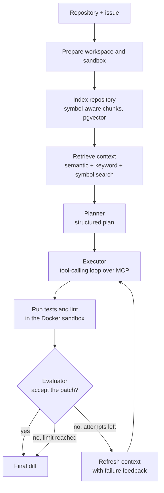

# PatchPilot

An autonomous software engineering agent. Given a repository and an issue, it retrieves the relevant code, plans a fix, edits files, runs the tests in an isolated Docker sandbox, evaluates its own patch, retries on failure, and returns a diff.

It is evaluated on SWE-bench Lite with the benchmark's official grading harness. The results below are small-sample and reported exactly as measured.

## Demo

**Live replay:** `<add Vercel URL after deploy>`

The demo replays three recorded benchmark runs step by step: the issue, the retrieved files, each attempt with its test results and evaluator feedback, the final diff, and the official grade. It is a static site with no backend and makes no model calls.

## Architecture



**Three agents, orchestrated by LangGraph.** A typed Pydantic state flows through the graph; every model output that drives control flow is a structured, validated schema.

- **Planner** turns the issue and retrieved code into a plan: the problem, the files that matter, the steps, the tests, the risks.
- **Executor** works in a tool-calling loop (up to 25 model turns per attempt). It reads, searches and edits the repository only through tools.
- **Evaluator** reviews the diff against the issue, the test results and the earlier failures, and returns a structured verdict. Real test results always overrule it: a patch with failing tests is never accepted.

**Feedback and retry loop.** A rejected attempt feeds its failing test output and the evaluator's written problems into the next attempt, up to 3 attempts.

**Code-aware retrieval.** Python is chunked along functions, classes and methods using the language's own parser, and Markdown along headings. Chunks are embedded locally (a code-trained embedding model through fastembed) and stored in PostgreSQL with pgvector. Search fuses three rankings with reciprocal rank fusion: vector similarity, Postgres full-text, and exact symbol-name matches. Test modules are indexed on demand, only when related to the code in play. Embeddings are cached by content, so a repository is embedded once across tasks and configurations.

**Context engineering.** Each prompt is assembled under a token budget (40K by default) split across the task, the plan, retrieved code, failure history and tool outputs. Older tool outputs are elided once they exceed their share, and earlier failures are summarized.

**Tools over MCP.** The executor's eight tools (`read_file`, `list_directory`, `search_code`, `edit_file`, `create_file`, `run_tests`, `run_linter`, `git_diff`) are served by an MCP server and discovered at runtime, not hardcoded into the agent. The tools refuse paths outside the repository and edits to existing test files.

**Disposable Docker sandbox.** Repository code never runs on the host. Each run gets its own container: non-root user, all capabilities dropped, read-only root filesystem, the workspace mounted read-only, no network, and CPU, memory, process and time limits. Containers remove themselves even if the agent crashes. API keys never enter the container.

**Observability.** With Langfuse keys set, every run is traced (graph nodes, model calls, tool calls, retries). A separate usage tracker records tokens, cost and latency, so metrics exist without tracing.

**Prompt caching.** The executor re-sends a growing conversation every turn, so the stable prefix (tools, system prompt, task, retrieved code) is cached. In benchmark runs with retrieval, 65 to 70% of input tokens were served from cache.

## Results

A component ablation on **8 tasks** drawn from SWE-bench Lite (5 Django, 3 SymPy), graded by the official SWE-bench harness. The task set is a seeded random draw, fixed before any run, that excludes every task used during development. Each row adds one component to the row above. Model: Claude Sonnet 5.

| Configuration | Tasks run | Resolved | Resolve rate | Cost / task | Tokens / task | Median latency |
|---|---|---|---|---|---|---|
| Baseline (executor + tests) | 8 | 4 | 50% | $0.54 | 308K | 98s |
| + RAG | 8 | 3 | 38% | $0.71 | 778K | 3,055s (one-time indexing) |
| + Planner | 8 | 4 | 50% | $1.42 | 1,316K | 428s |
| + Evaluator (full pipeline) | 6 | 2 | 33% | $1.35 | 1,380K | 494s |

How to read this:

- **Eight tasks is a small sample.** One task is 12.5 percentage points, so these differences are within noise and do not rank the configurations.
- **On this sample, added components did not raise the resolve rate.** They raised cost per task by up to about 2.6x over the baseline. That is the measured result, and it is what the findings below investigate.
- **The full-pipeline row is not directly comparable.** It ran 6 of the 8 tasks before the API budget was exhausted, and 3 of those 6 runs ended in errors: a truncated planner reply, a crash inside the tool session, and an API credit error. The first two were bugs, fixed afterwards (see Robustness). One of the errored runs still produced a patch the grader resolved.
- **The + RAG latency is mostly one-time indexing.** It was the first configuration to embed each repository. With the embedding cache warm, the same tasks ran in 136 to 1,760 seconds under + Planner.

Supporting metrics:

| Metric | Baseline | + RAG | + Planner | + Evaluator |
|---|---|---|---|---|
| Retrieval recall (reference-patch file in the top 5) | n/a | 50% | 62% | 83% |
| Input tokens served from prompt cache | 29% | 69% | 65% | 70% |
| Agent accepted its own patch | 88% | 100% | 75% | 33% |
| Of accepted patches, share the grader resolved | 43% | 38% | 50% | 0% |
| Average retries | 0.25 | 0.00 | 0.50 | 0.50 |
| 95th-percentile latency | 385s | 8,867s | 1,760s | 1,150s |

Retrieval precision is not reported as a headline: with five files retrieved and one file in each reference patch, it cannot exceed 20%.

All per-task results, predictions and grader logs are in [`evals/results/bench`](evals/results/bench). The planned context-engineering comparison (dynamic context against a full-history baseline) and the 20-task headline set are implemented in the harness but have not been run.

## Engineering findings

### Self-evaluation calibration

The agent's own verdict and the official grader disagree, and I measured by how much. *Self-acceptance precision* is the share of patches the agent accepted that the grader also resolved.

On a development task, the evaluator rejected a patch the grader had resolved. Three causes: a prompt that told it to be strict without defining a real gap, an acceptance rule that treated "correct, but retry" as a rejection, and an evaluator that did not know the executor cannot edit existing tests. I changed the rule so that passing target tests can only be overruled by a concrete, named problem, rewrote the prompt to say what does and does not count, and added regression tests for the exact case.

The benchmark then showed the disagreement is not only over-rejection. Under the full pipeline the agent accepted two patches, neither resolved, and did not accept two that were (one of those runs crashed before a verdict). The underlying cause is a weak verification signal: SWE-bench's deciding tests are hidden, and the existing tests the agent can run usually pass before any fix. In a dry run, the selected tests passed at the unfixed commit on all three tasks checked. Giving the agent a signal that actually changes with the fix is the open problem here.

### Test-edit guard: cheat prevention against valid test updates

The tools block edits to existing test files, because rewriting a test is the easiest way for an agent to "pass". Replay analysis showed the cost of that guard. On `django-11049` the fix corrects an error message, and an existing test asserts the old message. The agent produced a patch the official grader resolved, but its own tests kept failing on that stale assertion, the evaluator kept asking for a test update the executor is not allowed to make, and the run used all three attempts without accepting its own patch.

This is a real design tradeoff: the same guard that prevents cheating blocks the legitimate test updates some fixes require. The planned change is to allow test edits and have the evaluator distinguish weakening an assertion from updating it to match a required behavior change. That change has not been made; it will be measured on held-out tasks before it is kept.

### Robustness

Benchmarking surfaced three failures that ended tasks as errors, not as wrong answers. Each was diagnosed to its cause and fixed with regression tests:

- **Truncated planner output.** On hard tasks the planner's JSON was cut off, because reasoning tokens count against the output limit. Fix: a higher limit, one retry with a reminder, then a minimal fallback plan built from retrieval.
- **Unparseable executor replies.** Fix: one retry, then the attempt ends early and the checks and evaluator still run on what was edited.
- **Opaque crashes.** A failure inside the executor's tool session was recorded only as "unhandled errors in a TaskGroup". Fix: errors are unwrapped to their real cause, cleanup is best-effort, and one crashing task can no longer take down a batch.

Every retry and fallback is recorded on the run, so results can report how many runs used one. A re-run of the full pipeline after these fixes was cut short by API usage limits, so the fixes are verified by tests and not yet by a complete benchmark run.

## Limitations

- Python repositories with a prepared SWE-bench environment only. It has not been run on arbitrary repositories.
- A small, budget-limited task sample; the full-pipeline configuration ran 6 of the 8 tasks.
- The agent's self-evaluation does not yet agree reliably with the official grader.

## Tech stack

Python 3.13 · LangGraph · LangChain (model wrappers and structured output) · Claude Sonnet 5 · MCP · PostgreSQL + pgvector · fastembed · Docker · Langfuse · SWE-bench · pytest · Next.js + TypeScript (demo)

## Run it locally

**Prerequisites:** Python 3.13, Docker, PostgreSQL 17 with pgvector, and Node.js for the demo.

```bash
python3.13 -m venv .venv && source .venv/bin/activate
pip install -r requirements.txt
cp .env.example .env                                    # add ANTHROPIC_API_KEY for real runs

createdb patchpilot && createdb patchpilot_test
psql -d patchpilot -c "CREATE EXTENSION IF NOT EXISTS vector"
psql -d patchpilot_test -c "CREATE EXTENSION IF NOT EXISTS vector"

docker build -t patchpilot-sandbox:latest sandbox/
```

**Tests.** 190 tests; the model is mocked, so the suite makes no API calls. It needs Docker and Postgres running.

```bash
python -m pytest -q
```

**One run** on the bundled example repository (uses the API; a few cents):

```bash
python -m agent.graph
```

**Evaluation harness** (details in [`evals/README.md`](evals/README.md); GPU setup in [`docs/vm_runbook.md`](docs/vm_runbook.md)):

```bash
python -m evals.run --suite ablation8 --dry-run          # check environments; no model calls
python -m evals.estimate                                 # cost estimate before spending
python -m evals.run --suite ablation8 --experiment ablation --name myrun --max-cost 10
python -m evals.grade evals/results/myrun                # official SWE-bench grader
python -m evals.report evals/results/myrun --suite ablation8
```

SWE-bench task images are 1 to 3 GB each and x86_64; on Apple Silicon they run under emulation.

**Demo:**

```bash
cd apps/web
npm install
npm run dev                                              # http://localhost:3000
```

The demo's data is exported from recorded runs with `python -m evals.export_replays`.

## Repository layout

```
agent/          LangGraph workflow, planner, executor, evaluator, prompts, context budget
retrieval/      chunking, embeddings, pgvector store, hybrid retriever
tools/          filesystem, git, test and lint tools; MCP server and client
sandbox/        Docker image, hardening flags, container runner
observability/  Langfuse tracing, token and cost tracking
evals/          SWE-bench harness, task sets, metrics, reports, results
apps/web/       Next.js replay demo
tests/          test suite
docs/           spec and VM runbook
```
